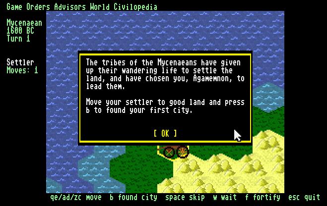

# Seven Ships of the Enemy

A Civilization-style hex-grid game for the **MEGA65**, in C.



## Building

Needs the [Calypsi 6502 tool chain](https://www.calypsi.cc/) (5.18 or later —
`cc6502`, `as6502`, `ln6502`), Python 3, Ruby (for the bundled
`tools/diskutil.rb`), and `xemu-xmega65` to run it. Pillow only if the tile art changes.

```sh
make            # build/sevenships.prg, build/sevenships.map and build/sevenships.d81
make run        # build them and boot the disk in xemu
make release    # build the disk and copy it into release/
make clean
```

**The game is the disk, not the PRG.** `build/sevenships.d81` holds the program
(as `autoboot.c65`), the tile sheet (`tiles.fci`) and the map (`sevenships.map`,
made at build time by `tools/mapgen.py`), and the program reads the last two
from drive 8 at start-up.

The board support — the C65-mode startup, the KERNAL stubs and the linker
rules — comes from [hth313/Calypsi-6502-Commodore][bsp], which ships inside the
tool chain and is selected by `--target=mega65`. There is nothing to clone.

[bsp]: https://github.com/hth313/Calypsi-6502-Commodore

## Where things are

- `src/` — the game. documentation/techreport.md describes the layers and the display.
- `res/tiles.fci` — the tile sheet, built from `tiles/*.png` by running
  `make` in `tiles/` (`tools/mktiles.py`). Checked in.
- `documentation/techreport.md` — the technical report: program structure,
  memory allocation, the main loop and how combat works.
- `res/text/` — the game's texts: the title, help and new-game screens, the
  opening popup, and the lists of names. `tools/mktext.py` packs them into
  `TEXT.PAK` on the disk, and the game reads them into attic RAM at start-up.
- `res/xemu-keymap.cfg` — gives xemu's keypad to the game; `make run` loads it.
- `documentation/design.md` — notes on hex grids and on how the original Civilization's map
  generator worked.

## Status

Milestones 1-4 of `TODO.txt` are in:

- a generated map that wraps east-west and scrolls, under a fog of war,
  with a minimap;
- a mouse or joystick pointer, a turn loop, and a menu bar — Game (Save
  Game, Retire), Orders (what the active unit can do), World (Top Five
  Cities, still empty) and Help (Keyboard Control) — opened with a click
  or MEGA and the title's first letter (Alt in xemu); development builds
  also have Debug, with Show Map and Play 50 Turns, which `make release`
  leaves out;
- saving and loading a game: Game/Save Game, and Load Saved Game on the
  title screen;
- settlers that found cities, and a city screen (click a city)
  where it is told to build warriors or builders;
- keyboard-only play: Tab puts a cursor on the map, the cursor keys move
  it and Return clicks;
- three computer players that found cities, guard them, build, explore
  and send out settlers to found more;
- combat after Civilization's rules: move onto an enemy to attack, and
  move into an empty enemy city to take it. Attacking another people
  declares war on it. Lose your last city and the game is over;
- barbarians, who appear in empty land from the fifteenth turn, attack
  whatever they meet and burn the cities they take.

HELP (F1 in xemu) shows a screen of every key and click. `0 -` / `p *` /
`: =` move a unit north-west and north-east, west and east, south-west and
south-east (keypad 7 9 / 4 6 / 1 3 in xemu, with `make run`'s keymap), and
the cursor keys scroll. Esc asks before quitting. Milestones 1-3 have
been played on a real MEGA65 with the mouse and the joystick, and saving,
loading and the texts in attic RAM have been tried there too. The game
quits back to BASIC's own screen.

## Credits

Most of the terrain, city and unit tiles are from [OpenCiv](https://github.com/RyanGrieb/OpenCiv)
by Ryan Grieb, with art commissioned for it from lucasyoung988, brysia and
pratamacam. They are licensed under
[CC BY 4.0](https://creativecommons.org/licenses/by/4.0/) (see OpenCiv's
[LICENSE](https://github.com/RyanGrieb/OpenCiv/blob/master/LICENSE) and
[issue #89](https://github.com/RyanGrieb/OpenCiv/issues/89)).

They have been modified for this game: scaled to 32×32 pixels, reduced to a
shared 240-colour palette, and widened at run time for the MEGA65's 640×200
display.

Additional graphics and tiles were created by myself for this game.

`tools/diskutil.rb`, which builds the disk image, was written by Fredrik
Ramsberg. Its sector interleave makes the disk load about five times faster
from a real floppy on a MEGA65.

## Licensing

- **Source code:** [MIT License](LICENSE).
- **Game assets:** [CC BY 4.0](https://creativecommons.org/licenses/by/4.0/).
  Art derived from OpenCiv remains under its original CC BY 4.0 terms; see
  Credits.
