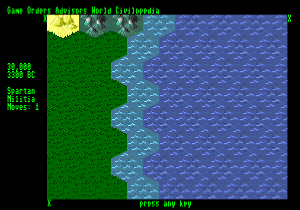

# Hexwar

A Civilization-style hex-grid game for the **MEGA65**, in C.



## Building

Needs the [Calypsi 6502 tool chain](https://www.calypsi.cc/) (5.18 or later —
`cc6502`, `as6502`, `ln6502`), Python 3, `c1541` (from VICE), and
`xemu-xmega65` to run it. Pillow only if the tile art changes.

```sh
make            # build/hexwar.prg, build/hexwar.map and build/hexwar.d81
make run        # build them and boot the disk in xemu
make clean
```

**The game is the disk, not the PRG.** `build/hexwar.d81` holds the program
(as `autoboot.c65`), the tile sheet (`tiles.fci`) and the map (`hexwar.map`,
made at build time by `tools/mapgen.py`), and the program reads the last two
from drive 8 at start-up.

The board support — the C65-mode startup, the KERNAL stubs and the linker
rules — comes from [hth313/Calypsi-6502-Commodore][bsp], which ships inside the
tool chain and is selected by `--target=mega65`. There is nothing to clone.

[bsp]: https://github.com/hth313/Calypsi-6502-Commodore

## Where things are

- `src/` — the game. `CLAUDE.md` describes the layers and the display.
- `res/tiles.fci` — the tile sheet, built from `tiles/*.png` by running
  `make` in `tiles/` (`tools/mktiles.py`). Checked in.
- `alltiles/` — the full OpenCiv tile collection the art is picked from.
- `TODO.txt` — the milestones.
- `basic/` — an earlier, more complete XC=BASIC 3 version, and the screenshot
  above. Not built by anything here; kept because it is the layout this is
  aiming at.
- `documentation/techreport.md` — the technical report: program structure,
  memory allocation and the main loop.
- `design.md` — notes on hex grids and on how the original Civilization's map
  generator worked.
- `old-cc65/` — the 2022 cc65 version this replaced. Kept until the rewrite has
  everything it had.

## Status

Milestone 1 of `TODO.txt`: a generated, east-west wrapping map that scrolls;
a mouse or joystick pointer; a turn loop; one settler, which can move and
found a city. Controls are listed along the bottom of the screen and in
`CLAUDE.md` (**The game**). Verified in xemu; not yet on a real MEGA65.

Next is milestone 2: a city screen, and building warriors and builders.

## Credits

The terrain, city and unit tiles are from [OpenCiv](https://github.com/RyanGrieb/OpenCiv)
by Ryan Grieb, with art commissioned for it from lucasyoung988, brysia and
pratamacam. They are licensed under
[CC BY 4.0](https://creativecommons.org/licenses/by/4.0/) (see OpenCiv's
[LICENSE](https://github.com/RyanGrieb/OpenCiv/blob/master/LICENSE) and
[issue #89](https://github.com/RyanGrieb/OpenCiv/issues/89)).

They have been modified for this game: scaled to 32×32 pixels, reduced to a
shared 240-colour palette, and widened at run time for the MEGA65's 640×200
display. The selection ring is drawn from the grass tile's outline.

## Licensing

- **Source code:** [MIT License](LICENSE).
- **Game assets:** [CC BY 4.0](https://creativecommons.org/licenses/by/4.0/).
  Art derived from OpenCiv remains under its original CC BY 4.0 terms; see
  Credits.
